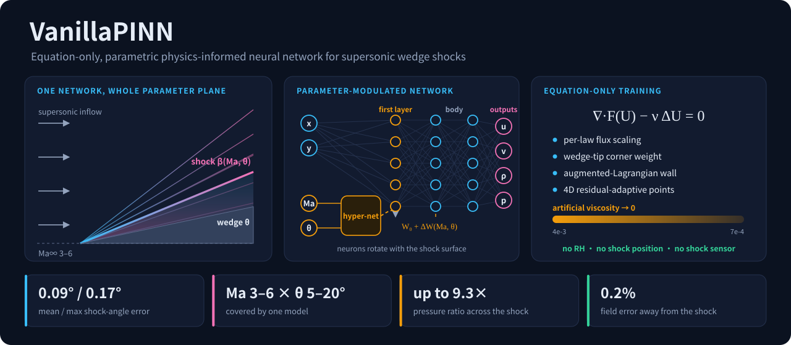
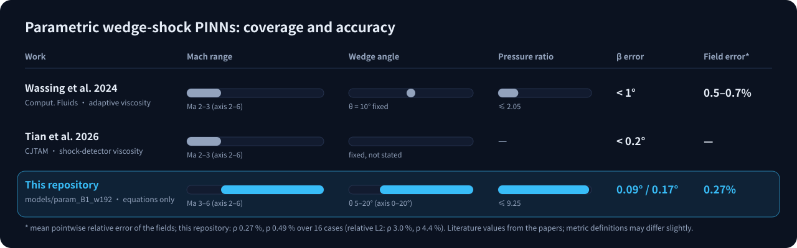
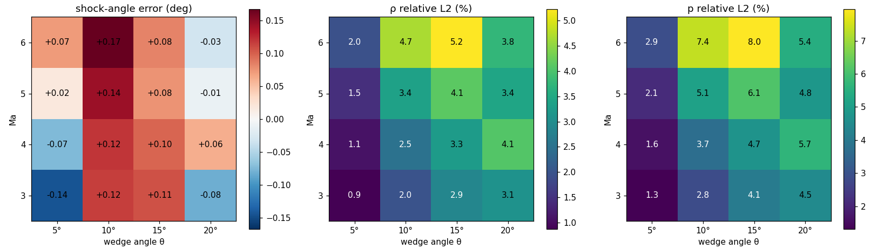
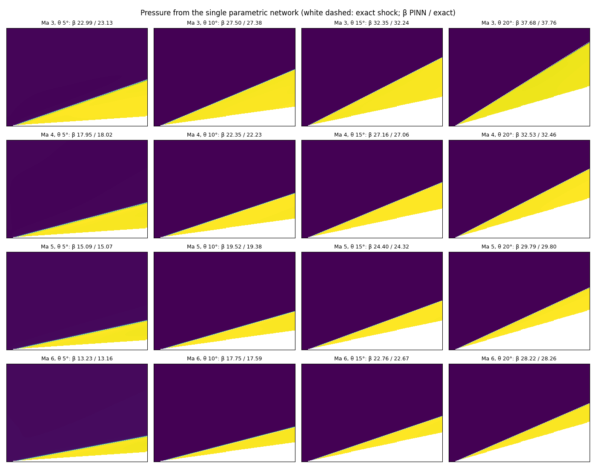
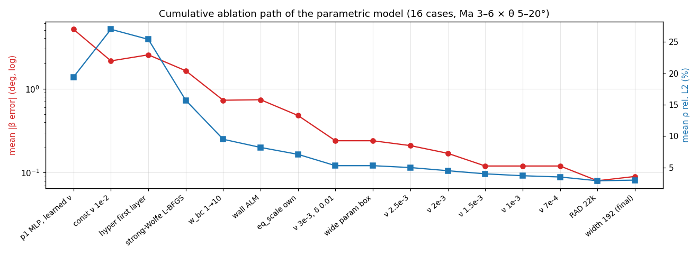

<p align="center"></p>

<p align="center">
  <b>English</b> · <a href="README_CN.md">中文</a> ·
  <a href="docs/method.md">Method</a> · <a href="docs/ablations.md">Ablations</a> · <a href="results/parametric/final_eval.md">Per-case results</a>
</p>

**VanillaPINN** contains the code and results of an undergraduate research project at Peking University. It solves supersonic wedge flow with oblique shocks using physics-informed neural networks (PINNs), as groundwork for PINN solvers of oblique detonation waves (ODW).

The main result is **one parametric network trained from the equations alone**.
- It takes (x, y, Ma, θ) as input and covers the whole **Ma 3–6 × wedge angle 5–20°** plane after a single training run.
- It uses no shock prior and no CFD data.
- On 16 evaluation cases, the shock-angle error is **0.09° mean and 0.17° max**.

## Key Advantages

| | This repository | Published parametric wedge PINNs |
|---|---|---|
| **Parameter space** | Mach number **and** wedge angle as inputs: a 2D parameter plane | Mach only (Ma 2–3), wedge angle fixed |
| **Shock strength** | pressure ratio 1.45–**9.25** | about 2 |
| **Priors / data** | **Equations only**: no RH condition, no shock position, no shock detector, no reference data | adaptive or shock-detector-guided viscosity |
| **Shock-angle error** | **0.09° mean, 0.17° max** (16 cases) | < 1° (Wassing 2024), < 0.2° (Tian 2026) |
| **Field error** (mean pointwise relative) | ρ **0.27%**, p **0.49%** | 0.5–0.7% (Wassing 2024) |

1. **Harder problem, higher accuracy.** Published parametric wedge cases are weak shocks: Ma 2–3, one wedge angle, pressure ratio about 2. This model reaches pressure ratio 9.25 and has one more parameter dimension. Its shock-angle error is still below the published results.
2. **Strictly equation-only.** The network is never told where the shock is.
   - The RH jump conditions come out of the vanishing-viscosity limit; they are never imposed.
   - Collocation points adapt only to the PDE residual.
   - Nothing is tuned per case, so a new wedge angle or Mach number needs no manual adjustment.
3. **Every ingredient has a theoretical justification and its own ablation.** There are eight:
   - vanishing viscosity
   - parameter-modulated first layer
   - per-law flux scaling
   - Kondratiev-type corner weighting
   - augmented Lagrangian wall condition
   - 4D residual-adaptive sampling
   - wider training box
   - function-preserving widening

   Each stage on the main path changes one thing. The 13 attempts that did not help are recorded too, in [docs/ablations.md](docs/ablations.md).
4. **The error budget is understood.** Almost all remaining field error is the shock thickness. Of the 4.4% pressure L2, 3.0 points is what a perfectly placed shock of the same thickness would score. Outside ±0.03 L of the shock, the error is 0.2%.
5. **Train once, query any case instantly.** The model has 229k parameters (0.9 MB) and evaluates 100k points in 0.18 s on a CPU. Any (Ma, θ) is one forward pass, with no re-run per case as in CFD.
6. **Optional refinement when more accuracy is needed.** For a single case, an automatic shock-detection + shock-fitting step brings the shock-angle error to ≤ 0.007° and the perturbation L2 vs exact to ≤ 7e-4. This step uses the RH condition, so it is reported separately from the equation-only results.

## Comparison with Published Work

<p align="center"></p>

| Work | Problem | Method | Shock-angle error | Field error |
|---|---|---|---|---|
| Wassing, Langer, Bekemeyer, *Comput. Fluids* 2024 | θ = 10° fixed, Ma 2–3 parametric | adaptive artificial viscosity, decreasing | < 1° | 0.5–0.7% |
| Tian, Sun, Zha et al., *Chin. J. Theor. Appl. Mech.* 2026, 58(1) | single wedge, Ma 2–3 parametric (fixed angle) | shock-detector-guided adaptive viscosity + layered resampling | < 0.2° | — (three-wedge inlet case < 1%) |
| Jagtap et al., *J. Comput. Phys.* 2022 | oblique shock, **inverse problem** with measured data | data + PINN | — | ρ L2 0.5–3.5% |
| **This repository** | **Ma 3–6 × θ 5–20°, both parametric** | **equations only** | **0.09° / 0.17°** | **ρ 0.27%, p 0.49%** |

Our survey ([literature survey](docs/literature_survey_cn.md), Chinese) found no published PINN result that covers Ma above 5 and several wedge angles at this accuracy. Literature values are taken from the papers; metric definitions may differ slightly.

## Method

The governing equations are the viscous Euler equations ∇·F(U) − ν(Ma)·ΔU = 0. The viscosity is scaled with the free-stream speed, which fixes the Reynolds number. Training starts at ν = 4e-3 and lowers ν stage by stage to 7e-4; each stage warm-starts from the previous one.

| Ingredient | Problem it solves | Justification |
|---|---|---|
| Constant artificial viscosity → 0 | jump and entropy conditions | Vanishing viscosity: the ν → 0 limit is the entropy solution, so RH holds automatically. The viscosity must be prescribed; a learned one grows, because the strong-form residual scales like 1/thickness. |
| Parameter-modulated first layer `--arch hyper` | shock surface rotates with the parameters | y = x·tanβ(Ma, θ) is not a plane in (x, y, Ma, θ). First-layer weights generated from (Ma, θ) follow it (shift-DeepONet / HyperPINN). |
| Per-law flux scaling `--eq_scale own` | unbalanced equations | Unscaled, the energy equation weighs about 440× the mass equation. |
| Tip corner weight r²/(r²+δ²) | geometric singularity at the wedge tip | Kondratiev-type weighted norm; uses geometry only. |
| Augmented-Lagrangian wall `--alm` | penalty bias weakens the shock | The multiplier absorbs the "trade wall accuracy for a weaker shock" bias (PECANN). |
| Strong-Wolfe L-BFGS | stiff optimisation | From the same start, 250 steps: loss 0.103 → 0.049. |
| 4D residual-adaptive sampling | shock thinner than point spacing | Points follow the residual only and land on the shock surface by themselves. |
| Wider training box + function-preserving widening | edge and corner errors; capacity | Edge error decays inward, roughly halving every 0.15 Ma. Widening changes the output by < 4e-7. |

Details: [Method](docs/method.md) (Chinese).

## Results

Final model `models/param_B1_w192`, 16 cases vs exact oblique-shock theory ([per-case table](results/parametric/final_eval.md)):

| Metric | Mean | Max |
|---|---|---|
| Shock-angle error | 0.09° | 0.17° |
| ρ / p mean pointwise relative error | 0.27% / 0.49% | — |
| ρ / p relative L2 | 3.0% / 4.4% | 5.2% / 8.0% |
| Field error outside ±0.03 L of the shock | 0.2% | — |
| Shock angle implied by post-shock pressure | 0.04° | — |




Single case (Ma 5) with shock-fitting refinement:

| Wedge | Shock angle (exact) | Perturbation L2 vs exact (u, v, ρ, p) |
|---|---|---|
| 10° | 19.375–19.378° (19.376°) | 4.9e-4, 1.5e-4, 2.2e-4, 2.4e-4 |
| 15° | 24.324–24.329° (24.322°) | 4.1e-4, 3.7e-5, 6.6e-4, 8.7e-5 |

## Ablations



The largest contributions. Each stage warm-starts from the previous one and changes only this item:

| Change | Shock-angle error mean / max | ρ relative L2 |
|---|---|---|
| Strong-Wolfe line search | 2.54° / 7.22° → 1.64° / 5.97° (thickness 0.15–0.17 → 0.05–0.08 L) | 25.4% → 15.7% |
| Boundary weight 1 → 10 | 1.46° / 5.08° → 0.73° / 1.92° | 13.2% → 9.5% |
| Augmented-Lagrangian wall | 0.97° / 3.61° → 0.74° / 2.21° | 9.1% → 8.2% |
| Per-law flux scaling | 0.76° / 2.13° → 0.48° / 0.96° | 8.2% → 7.1% |
| Viscosity 3e-3 → 7e-4 (5 stages, Ma lower bound 2.85 → 2.7 on the way) | 0.24° / 0.52° → 0.12° / 0.20° | 5.3% → 3.5% |
| Residual-adaptive points 15k → 22k | 0.12° / 0.20° → 0.08° / 0.22° | 3.5% → 2.9% |

Did not help:
- learned viscosity
- polar coordinates
- mirror wall conditions
- integral-form loss
- snapshot averaging
- more collocation points
- lower viscosity

Full record: [docs/ablations.md](docs/ablations.md) (Chinese).

## Repository Contents

```
VanillaPINN/
├── wedge_pinn/                 # solver
│   ├── param_pinn.py           # parametric equation-only PINN (main result)
│   ├── capture_lv.py           # single-case shock-capturing PINN
│   ├── refine.py, shockfit.py  # automatic shock detection + shock-fitting refinement
│   ├── physics.py, model.py, data.py, evaluate.py
│   ├── diag_param/             # diagnostics: conservation across the shock, error split, precise shock angle, corner scans
│   ├── scripts/train_param.sh  # full training chain of the final model
│   └── data/                   # cached OpenFOAM reference fields (10°, 15°)
├── models/param_B1_w192/       # final model
├── results/                    # result tables
├── docs/                       # method, ablations, literature survey
└── assets/                     # figures on this page (src/ = generator)
```

## Usage

Python 3.10, PyTorch 2.5 (trained on an RTX 4060 8 GB); see `requirements.txt`.

```bash
cd wedge_pinn
python diag_param/eval_param.py ../models/param_B1_w192   # evaluate the final model (CPU, ~5 min)
bash scripts/train_param.sh                                # train from scratch (~12-14 h)
```

## References

- S. Wassing, S. Langer, P. Bekemeyer. Physics-informed neural networks for parametric compressible Euler equations. *Computers & Fluids*, 2024.
- Tian Xinhui, Sun Zhensheng, Zha Bolin, Zhu Yujie, Hu Yu, Fu Liushuo. Research on the shock detector-guided adaptive viscosity PINN method. *Chinese Journal of Theoretical and Applied Mechanics*, 2026, 58(1): 43–61. doi:10.6052/0459-1879-25-434
- A. D. Jagtap, Z. Mao, N. Adams, G. E. Karniadakis. Physics-informed neural networks for inverse problems in supersonic flows. *J. Comput. Phys.*, 2022.
- S. Lanthaler, R. Molinaro, P. Hadorn, S. Mishra. Nonlinear reconstruction for operator learning of PDEs with discontinuities. *ICLR*, 2023.
- S. Basir, I. Senocak. Physics and equality constrained artificial neural networks (PECANN). *J. Comput. Phys.*, 2022.
