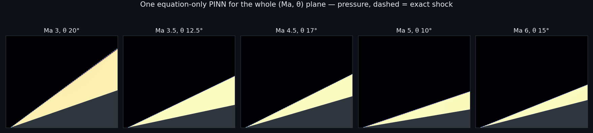

[](README.md)
[](README_CN.md)
[](docs/method.md)
[](https://pytorch.org)
[](https://www.python.org)

VanillaPINN 是北京大学本科科研项目的代码：用物理信息神经网络（PINN）求解**超声速楔面流动和斜激波**，最终目标是斜爆轰波（ODW）。

核心成果是**一个只靠方程训练、覆盖整个 (Ma, θ) 平面的参数化网络**：
- 输入是 (x, y, 马赫数, 楔角)。
- 不给 RH 条件，不给激波位置，也不按激波位置加点。
- 在 Ma 3–6 × θ 5–20° 范围内，激波角误差**平均 0.09°、最大 0.17°**。
- 离激波稍远（±0.03 L 以外），流场误差只有 **0.2%**。

> 只靠方程，一次给出所有马赫数和楔角下的激波。

# 🚀 快速开始

### 环境

| 项目 | 本项目使用 |
|---|---|
| **Python** | 3.10 |
| **PyTorch** | 2.5.1 + CUDA 12（评估可以只用 CPU） |
| **GPU** | RTX 4060 8 GB，一次只跑一个训练；每段 500 步 L-BFGS 约 35–70 分钟 |
| **其他** | numpy、scipy、matplotlib（`pip install -r requirements.txt`） |

### 评估发布的模型（CPU，约 5 分钟）

```bash
git clone https://github.com/csxq0605/VanillaPINN.git
cd VanillaPINN/wedge_pinn
pip install -r ../requirements.txt
python diag_param/eval_param.py ../models/param_B1_w192        # 16 个工况对理论解的逐工况表
python make_figures.py                                           # 图在 assets/，表在 results/parametric/
```

### 任意 (Ma, θ) 下取值

```python
import json, math, torch
from param_pinn import PConfig, ParamPINN, predict
cfg = PConfig(**json.load(open("../models/param_B1_w192/config.json")))
net = ParamPINN(cfg); net.load_state_dict(torch.load("../models/param_B1_w192/model_final.pt", map_location="cpu")); net.eval()
x, y = torch.rand(1000), 0.5 * torch.rand(1000)
q = predict(net, x, y, 4.5, math.radians(12.5), torch.device("cpu"))   # 各列为 u, v, ρ, p（ρ∞ = p∞ = 1）
```

### 训练

```bash
cd wedge_pinn
bash scripts/train_param.sh            # 参数化模型：完整的接续训练链（单张 8 GB 显卡约 12–14 小时）
python capture_lv.py --width 64 --depth 6 --normalize_inputs true --nu_wall 0.05 --n_rad 10000 \
       --rad_every 200 --rad_until 400 --w_weak 10 --adam_iters 500 --nu_min 2e-3 --tag lvf   # 单工况：激波捕捉
python refine.py --capture runs/<捕捉的 run 目录> --tag refine                                    # 自动识别 + 激波装配精修
```

所有配置项都可以用 `--字段名 值` 覆盖，字段定义见 `param_pinn.py`、`capture_lv.py`、`shockfit.py` 顶部的 dataclass。

# ✨ 关键创新点

| 创新点 | 说明 |
|---|---|
| **🧮 只用方程的激波捕捉** | 方程是粘性 Euler 方程，常数人工粘性逐步减小（4e-3 → 7e-4）。RH 跳跃条件由粘性消失极限自动满足，从不手工加入。 |
| **🎛️ 参数调制首层** | 首层权重由 (Ma, θ) 的小网络生成。激波面 y = x·tanβ(Ma, θ) 在输入空间里不是平面，这样神经元能随它一起转动（思路来自 shift-DeepONet / HyperPINN）。 |
| **⚖️ 各守恒律按自身通量归一** | 不归一时，能量方程的权重约为质量方程的 440 倍。只改这一项，激波角平均误差就从 0.76° 降到 0.48°。 |
| **📐 楔尖角点加权** | 残差乘以 r²/(r²+δ²)，即 Kondratiev 型角点加权范数，处理楔尖这个几何奇点，只用到几何。 |
| **🔗 壁面增广拉格朗日** | 消除罚函数法"牺牲壁面条件、换一道更弱的激波"的偏差，壁面少转从 0.6–2.6° 降到 0.1–0.7°。 |
| **🎯 四维残差自适应加点** | 在 (x, y, Ma, θ) 里按残差重新采样，点自然集中到激波面上，不需要任何激波信息。 |
| **🧱 放宽训练参数域，保持函数不变地加宽网络** | 训练参数域比使用范围宽一圈，消除参数域边、角上的误差；`widen_model.py` 加宽网络而不改变输出（差别 < 4e-7）。 |
| **🔬 捕捉 → 识别 → 装配流程** | 单工况上先捕捉激波、自动识别，再用显式激波曲线精修。激波角误差 ≤ 0.007°，对精确解的扰动 L2 ≤ 7e-4。 |
| **🩺 诊断工具** | `wedge_pinn/diag_param/` 下共 16 个脚本，包括跨激波守恒检查、激波带内外误差和厚度下限、激波角精测、角点细扫、二维误差 / 熵 / 残差图等。 |

# 📊 结果

**参数化模型**（`models/param_B1_w192`，16 个工况对理论精确解，评估窗口 y ≤ 0.9，[逐工况表](results/parametric/final_eval.md)）：

| | 平均 | 最大 |
|---|---|---|
| 激波角误差 | 0.09° | 0.17° |
| ρ 相对 L2 | 3.0% | 5.2% |
| p 相对 L2 | 4.4% | 8.0% |

p 的 4.4% 里有 **3.0 个百分点是激波厚度下限**，即一道位置完全正确、只是有同样厚度的激波也会有的误差。离激波 ±0.03 L 以外，误差只有 0.2%。用激波后压力反推的激波角，平均误差只有 0.04°。


**单工况，Ma 5**（捕捉 → 识别 → 装配）：

| 算例 | 激波角（精确） | 对精确解扰动 L2（u, v, ρ, p） |
|---|---|---|
| 10° 楔面 | 19.375–19.378°（19.376°） | 4.9e-4, 1.5e-4, 2.2e-4, 2.4e-4 |
| 15° 楔面 | 24.324–24.329°（24.322°） | 4.1e-4, 3.7e-5, 6.6e-4, 8.7e-5 |

单靠激波捕捉、不给先验时（10°，3 个随机种子），对 OpenFOAM 的全场相对 L2 为 ρ 1.0–1.3%、p 1.8–2.5%。

# 🧪 消融实验

参数化模型是一段段接着训出来的，每一段只改一项。下图是主线上激波角平均误差和 ρ L2 的变化。完整表格（包括没用的做法）见 **[docs/ablations.md](docs/ablations.md)**。试过但没用的做法：
- 可学习粘性
- 极坐标输入
- 镜面壁面条件
- 快照平均
- 增加 RAD 点数
- 粘性 5e-4（宽度 128 和 192 都试过）


# 📁 目录结构

```
VanillaPINN/
├── wedge_pinn/                 # 主体代码
│   ├── param_pinn.py           # 参数化、只用方程的 PINN，输入 (x, y, Ma, θ)
│   ├── capture_lv.py           # 单工况激波捕捉 PINN
│   ├── refine.py, shockfit.py  # 自动识别激波 + 激波装配精修
│   ├── physics.py, model.py, data.py, evaluate.py
│   ├── widen_model.py          # 保持函数不变地加宽网络
│   ├── make_figures.py         # 为发布的模型生成图和表
│   ├── diag_param/             # 参数化模型的诊断脚本
│   ├── scripts/train_param.sh  # 发布模型的完整训练链
│   ├── data/                   # OpenFOAM 参考解缓存（10°、15°）和 Fluent 网格点
│   └── capture.py, train.py, main.py, diag_*.py, compare.py, summarize.py   # 对照实验和单工况工具
├── models/param_B1_w192/       # 发布的模型（config.json 是评估窗口，train_config.json 是训练配置）
├── results/                    # 参数化 16 工况表、单工况各方法对比表和图
├── docs/                       # 方法说明、消融实验、文献调研
├── assets/                     # README 用图
└── legacy/vanilla_fnn/         # 本仓库最初的 vanilla PINN 代码
```

# 📖 文档

- **[方法说明](docs/method.md)**：问题设置、两条路线，以及每个组成部分的理论依据
- **[消融实验](docs/ablations.md)**：全部消融表和没用的做法
- **[文献调研](docs/literature_survey_cn.md)**：PINN 处理激波的方法，分为"只依赖方程"和"强先验"两类

# 🗺️ 下一步

- **斜爆轰波：** 加入组分或反应进度和对应的源项（单步 Arrhenius，或两步诱导–放热模型）。前导激波就是这里已经解决的斜激波。
- **更薄的激波：** 粘性降到 7e-4 以下，需要比目前更大的网络容量或分辨率。
- **参数化的激波装配：** 精修网络和激波曲线都以 (Ma, θ) 为条件。
