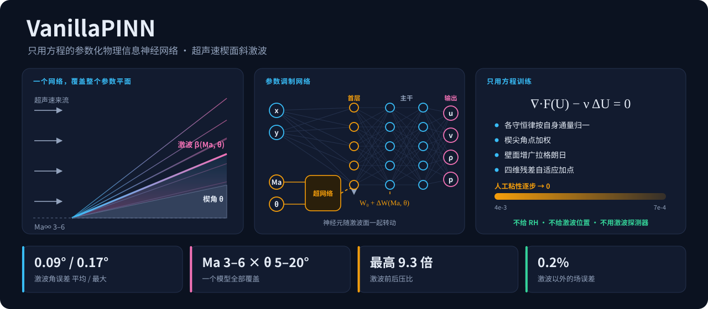
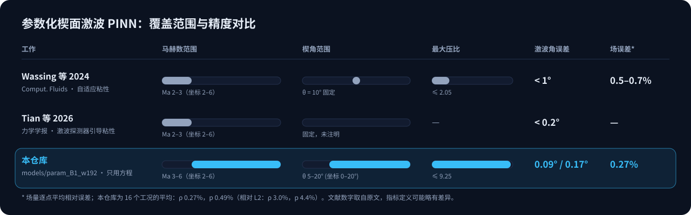
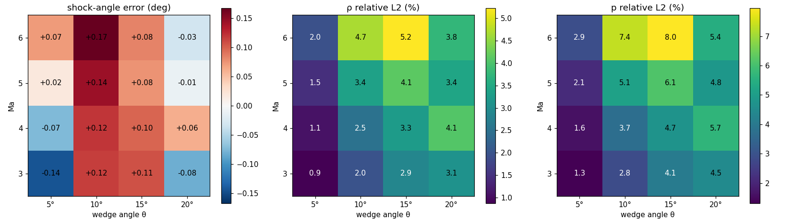
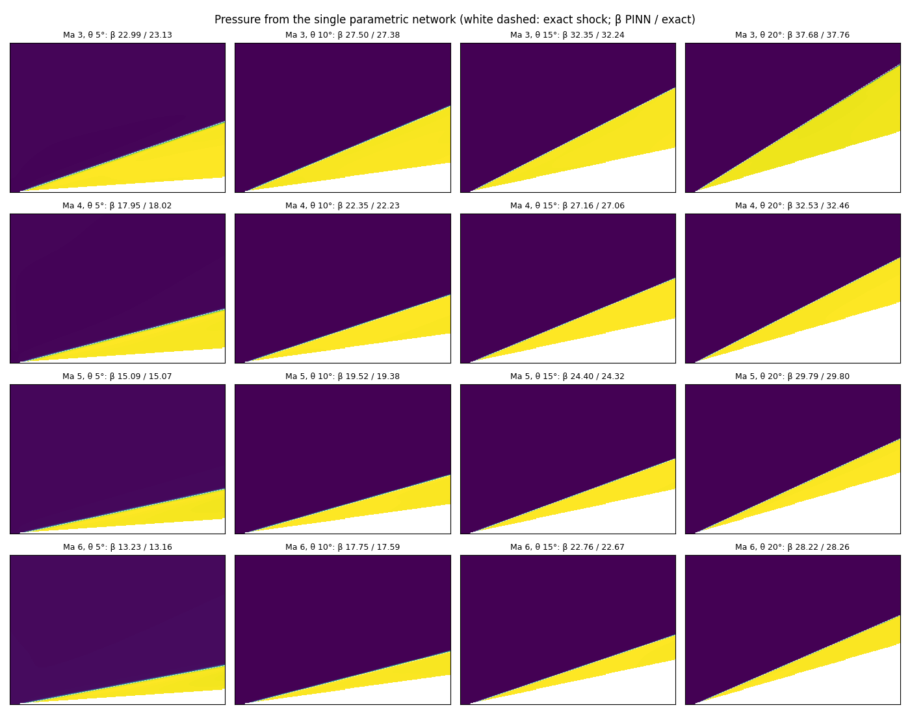
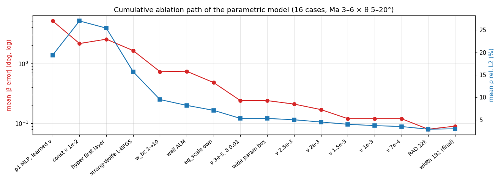

<p align="center"></p>

<p align="center">
  <a href="README.md">English</a> · <b>中文</b> ·
  <a href="docs/method.md">方法说明</a> · <a href="docs/ablations.md">消融实验</a> · <a href="results/parametric/final_eval.md">逐工况结果</a>
</p>

**VanillaPINN** 是北京大学本科科研项目的代码与成果：用物理信息神经网络（PINN）求解超声速楔面斜激波，目标是为斜爆轰波（ODW）的 PINN 求解打基础。

本仓库的核心成果是**一个只靠方程训练的参数化网络**：
- 输入 (x, y, Ma, θ)，一次训练就覆盖 **Ma 3–6 × 楔角 5–20°** 的整个参数平面；
- 不用任何激波先验，也不用任何 CFD 数据；
- 16 个评估工况上激波角误差 **平均 0.09°、最大 0.17°**。

## 核心优势

| | 本仓库 | 已有参数化楔面 PINN |
|---|---|---|
| **参数空间** | 马赫数和楔角**同时**作为输入，覆盖二维参数平面 | 只有马赫数可变（Ma 2–3），楔角固定 |
| **激波强度** | 压比 1.45–**9.25** | 约 2 |
| **先验和数据** | **只用方程**：不给 RH 条件、不给激波位置、不用激波探测器，也不用参考解数据 | 自适应粘性或激波探测器引导的粘性 |
| **激波角误差** | **平均 0.09°、最大 0.17°**（16 个工况） | < 1°（Wassing 2024）、< 0.2°（Tian 等 2026） |
| **场量误差**（逐点平均相对误差） | ρ **0.27%**、p **0.49%** | 0.5–0.7%（Wassing 2024） |

1. **问题更难，精度反而更高。** 文献里的参数化楔面算例都是弱激波（Ma 2–3、单一楔角，压比约 2）。本仓库的压比最高 9.25，参数空间多出一维。在这种条件下，激波角误差仍低于已发表的结果。
2. **严格只用方程。** 激波位置、RH 跳跃条件都不告诉网络，而是让粘性消失极限自己产生；配点也只按方程残差自适应。因此方法不依赖具体工况，换一个楔角、马赫数不需要任何人工调整。
3. **每个组成部分都有理论依据，并逐项做了消融。** 共 8 个组成部分，每一项都对应一条可以说清楚的理由：粘性消失法、参数调制首层、按各守恒律自身通量归一、Kondratiev 型角点加权、增广拉格朗日、四维残差自适应、放宽训练参数域、保持函数不变的加宽。主线上每一步只改一项，没用的做法（13 项）也如实记录，见 [docs/ablations.md](docs/ablations.md)。
4. **误差来源清楚。** 剩下的场误差几乎都是激波厚度本身：p 的 4.4% L2 中有 3.0 个百分点，是一道位置完全正确、只是有同样厚度的激波也会有的误差。离激波 ±0.03 L 以外，误差只有 0.2%。
5. **训练一次，任意工况即时出解。** 模型 23 万参数（0.9 MB），在 CPU 上算 10 万个点只要 0.18 s，任意 (Ma, θ) 都能直接查询，不需要像 CFD 那样每个工况重算一次。
6. **需要更高精度时还有精修。** 单工况上可以接一个"自动识别激波 + 激波装配"的精修步骤，把激波角误差降到 ≤ 0.007°、对精确解的扰动 L2 降到 ≤ 7e-4。这一步用了 RH 条件，因此单独列出，不算在"只用方程"的结果里。

## 与已有工作对比

<p align="center"></p>

| 工作 | 问题 | 方法 | 激波角误差 | 场误差 |
|---|---|---|---|---|
| Wassing, Langer, Bekemeyer, *Comput. Fluids* 2024 | 楔角 10° 固定，Ma 2–3 参数化 | 自适应人工粘性 + 粘性递减 | < 1° | 0.5–0.7% |
| Tian, Sun, Zha et al.，《力学学报》2026, 58(1) | 单楔，Ma 2–3 参数化（楔角固定） | 激波探测器引导的自适应粘性 + 分层重采样 | < 0.2° | —（三楔进气道算例 < 1%） |
| Jagtap et al., *J. Comput. Phys.* 2022 | 斜激波**反问题**，用到测量数据 | 数据 + PINN | — | ρ L2 0.5–3.5% |
| **本仓库** | **Ma 3–6 × θ 5–20°，同时参数化** | **只用方程** | **0.09° / 0.17°** | **ρ 0.27%、p 0.49%** |

据我们的调研（[文献调研](docs/literature_survey_cn.md)），还没有覆盖 Ma 5 以上、多个楔角并达到这种精度的已发表 PINN 结果。文献数字取自原文，指标定义可能略有差异。

## 方法

方程为粘性 Euler 方程 ∇·F(U) − ν(Ma)·ΔU = 0，人工粘性随来流速度缩放，即固定雷诺数。训练从 ν = 4e-3 开始，每段都从上一段的解接着训练，逐步把 ν 降到 7e-4。

| 组成部分 | 解决的问题 | 理论依据 |
|---|---|---|
| 常数人工粘性逐步 → 0 | 跳跃条件和熵条件 | 粘性消失法：ν → 0 的极限就是满足熵条件的弱解，RH 条件自动成立。粘性必须由外部给定，否则网络会把它调大，因为强形式残差在激波内 ∝ 1/厚度。 |
| 参数调制首层 `--arch hyper` | 激波面随参数转动 | y = x·tanβ(Ma, θ) 在 (x, y, Ma, θ) 空间里不是平面；首层权重由 (Ma, θ) 生成，即 shift-DeepONet / HyperPINN 的思路 |
| 各守恒律按自身通量归一 `--eq_scale own` | 方程权重失衡 | 不归一时能量方程约为质量方程的 440 倍 |
| 楔尖角点加权 r²/(r²+δ²) | 楔尖几何奇点 | Kondratiev 型角点加权范数，只用到几何 |
| 壁面增广拉格朗日 `--alm` | 罚函数法让激波偏弱 | 乘子吸收"牺牲壁面条件、换弱激波"的偏差（PECANN） |
| 强 Wolfe 线搜索 L-BFGS | 刚性优化问题 | 同一起点训练 250 步，损失从 0.103 降到 0.049 |
| 四维残差自适应加点 | 激波薄于配点间距 | 只按残差采样，点自然落到激波面上 |
| 训练参数域比使用范围宽 + 保持函数不变的加宽 | 参数域边、角上的误差；网络容量 | 边界误差向内平滑衰减（大约每 0.15 Ma 减半）；加宽前后输出差 < 4e-7 |

详见[方法说明](docs/method.md)。

## 结果

最终模型 `models/param_B1_w192`，16 个工况对斜激波理论精确解（[逐工况表](results/parametric/final_eval.md)）：

| 指标 | 平均 | 最大 |
|---|---|---|
| 激波角误差 | 0.09° | 0.17° |
| ρ / p 逐点平均相对误差 | 0.27% / 0.49% | — |
| ρ / p 相对 L2 | 3.0% / 4.4% | 5.2% / 8.0% |
| 激波以外（±0.03 L）的场误差 | 0.2% | — |
| 由激波后压力反推的激波角误差 | 0.04° | — |




单工况（Ma 5）加上激波装配精修后：

| 楔角 | 激波角（精确值） | 对精确解扰动 L2（u, v, ρ, p） |
|---|---|---|
| 10° | 19.375–19.378°（19.376°） | 4.9e-4, 1.5e-4, 2.2e-4, 2.4e-4 |
| 15° | 24.324–24.329°（24.322°） | 4.1e-4, 3.7e-5, 6.6e-4, 8.7e-5 |

## 消融实验



贡献最大的几步（每一步都从上一步的解接着训练，且只改这一项）：

| 改动 | 激波角误差 平均 / 最大 | ρ 相对 L2 |
|---|---|---|
| 强 Wolfe 线搜索 | 2.54° / 7.22° → 1.64° / 5.97°（激波厚度 0.15–0.17 → 0.05–0.08 L） | 25.4% → 15.7% |
| 边界权重 1 → 10 | 1.46° / 5.08° → 0.73° / 1.92° | 13.2% → 9.5% |
| 壁面增广拉格朗日 | 0.97° / 3.61° → 0.74° / 2.21° | 9.1% → 8.2% |
| 各守恒律按自身通量归一 | 0.76° / 2.13° → 0.48° / 0.96° | 8.2% → 7.1% |
| 粘性 3e-3 → 7e-4（5 段，期间 Ma 下限 2.85 → 2.7） | 0.24° / 0.52° → 0.12° / 0.20° | 5.3% → 3.5% |
| 残差自适应点 1.5 万 → 2.2 万 | 0.12° / 0.20° → 0.08° / 0.22° | 3.5% → 2.9% |

试过但没用的做法：可学习粘性、极坐标输入、镜面壁面条件、积分形式损失、快照平均、继续增加配点、更低的粘性。完整记录见 [docs/ablations.md](docs/ablations.md)。

## 仓库内容

```
VanillaPINN/
├── wedge_pinn/                 # 求解器
│   ├── param_pinn.py           # 参数化、只用方程的 PINN（主要成果）
│   ├── capture_lv.py           # 单工况激波捕捉 PINN
│   ├── refine.py, shockfit.py  # 自动识别激波 + 激波装配精修
│   ├── physics.py, model.py, data.py, evaluate.py
│   ├── diag_param/             # 诊断：跨激波守恒、误差拆分、激波角精测、参数域角点扫描等
│   ├── scripts/train_param.sh  # 最终模型的完整训练链
│   └── data/                   # OpenFOAM 参考解缓存（10°、15°）
├── models/param_B1_w192/       # 最终模型
├── results/                    # 结果表
├── docs/                       # 方法说明、消融实验、文献调研
└── assets/                     # 本页图片（src/ 为生成脚本）
```

## 使用

环境：Python 3.10，PyTorch 2.5（训练用 RTX 4060 8 GB），依赖见 `requirements.txt`。

```bash
cd wedge_pinn
python diag_param/eval_param.py ../models/param_B1_w192   # 评估最终模型（CPU 约 5 分钟）
bash scripts/train_param.sh                                # 从头训练（约 12–14 小时）
```

## 参考文献

- S. Wassing, S. Langer, P. Bekemeyer. Physics-informed neural networks for parametric compressible Euler equations. *Computers & Fluids*, 2024.
- Tian Xinhui, Sun Zhensheng, Zha Bolin, Zhu Yujie, Hu Yu, Fu Liushuo. Research on the shock detector-guided adaptive viscosity PINN method. 《力学学报》(*Chinese Journal of Theoretical and Applied Mechanics*), 2026, 58(1): 43–61. doi:10.6052/0459-1879-25-434
- A. D. Jagtap, Z. Mao, N. Adams, G. E. Karniadakis. Physics-informed neural networks for inverse problems in supersonic flows. *J. Comput. Phys.*, 2022.
- S. Lanthaler, R. Molinaro, P. Hadorn, S. Mishra. Nonlinear reconstruction for operator learning of PDEs with discontinuities. *ICLR*, 2023.
- S. Basir, I. Senocak. Physics and equality constrained artificial neural networks (PECANN). *J. Comput. Phys.*, 2022.
