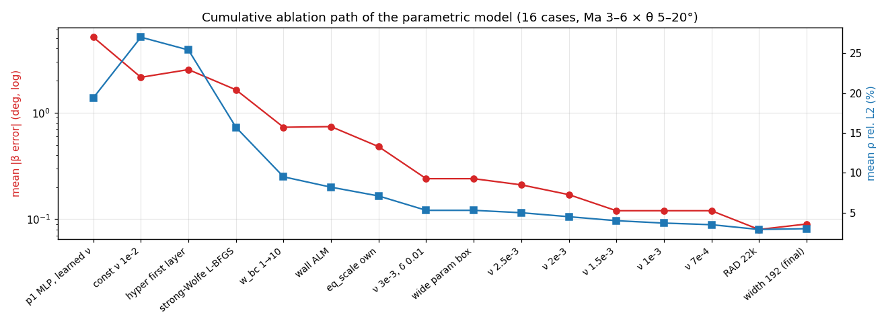

# 消融实验

[← 返回 README](../README_CN.md) · [方法说明](method.md)

所有数字都是**对斜激波理论精确解**的结果（单工况部分另注明对 CFD）。参数化模型的评估：Ma {3, 4, 5, 6} × θ {5°, 10°, 15°, 20°} 共 16 个工况，窗口 y ≤ 0.9。"累计步数"指从头算起的 L-BFGS 步数，每一行都从上一行的解接着训练。

## 1. 参数化模型：主线（每一步只改一项）

| 阶段 | 相对上一行的改动 | 累计步数 | 激波角误差 平均 / 最大 | ρ L2 | p L2 | 激波厚度 |
|---|---|---|---|---|---|---|
| p1 | 普通 MLP，可学习粘性 | 1000 | 5.12° / 8.35° | 19.4% | 33.3% | 0.2–0.3 L |
| A | 常数粘性 1e-2 | 500 | 2.15° / 6.22° | 27.0% | 31.8% | 0.14–0.17 L |
| E | **参数调制首层**（`--arch hyper`） | 250 | 2.54° / 7.22° | 25.4% | 31.4% | 0.15–0.17 L |
| E2 | **强 Wolfe 线搜索** | 500 | 1.64° / 5.97° | 15.7% | 21.8% | 0.05–0.08 L |
| F1 | 继续训练到收敛 | 1000 | 1.46° / 5.08° | 13.2% | 18.9% | 0.05 L |
| G2 | **边界权重 1 → 10** | 1500 | 0.73° / 1.92° | 9.5% | 13.6% | 0.04–0.065 L |
| I2 | 粘性 → 4e-3，边界权重 25 | 2250 | 0.97° / 3.61° | 9.1% | 14.0% | 0.019–0.043 L |
| J1 | **壁面增广拉格朗日**（`--alm`） | 2500 | 0.74° / 2.21° | 8.2% | 12.7% | 0.018–0.034 L |
| M1 | **各守恒律按自身通量归一**（`--eq_scale own`） | 3000 | 0.48° / 0.96° | 7.1% | 10.4% | 0.016–0.043 L |
| M3 | 楔尖权重 δ 0.03 → 0.01，训到 750 步 | 3500 | 0.29° / 0.59° | 6.0% | 8.7% | 0.016–0.042 L |
| O2 | 粘性 → 3e-3 | 3750 | 0.24° / 0.77° | 5.3% | 7.7% | 0.012–0.034 L |
| P1 | **训练参数域放宽**：Ma 2.85–6.25、θ 3.5–21° | 3950 | 0.24° / 0.52° | 5.3% | 7.8% | 0.012–0.034 L |
| Q1 | 粘性 → 2.5e-3 | 4450 | 0.21° / 0.41° | 5.0% | 7.3% | 0.009–0.029 L |
| R1 | 粘性 → 2e-3 | 4950 | 0.17° / 0.34° | 4.5% | 6.5% | 0.007–0.025 L |
| S1 | 粘性 → 1.5e-3 | 5450 | 0.12° / 0.36° | 4.0% | 5.8% | 0.006–0.019 L |
| T1 | Ma 下限 2.85 → 2.7 | 5950 | 0.13° / 0.27° | 4.0% | 5.8% | 0.006–0.019 L |
| U1 | 粘性 → 1e-3 | 6450 | 0.12° / 0.29° | 3.7% | 5.4% | 0.004–0.013 L |
| V1 | 粘性 → 7e-4 | 6950 | 0.12° / 0.20° | 3.5% | 5.2% | 0.003–0.010 L |
| W1 | **RAD 点 1.5 万 → 2.2 万** | 7450 | 0.08° / 0.22° | 2.9% | 4.3% | 0.002–0.009 L |
| A1 | Ma 下限 → 2.5、上边界 0.9 → 1.05 | 7950 | 0.11° / 0.17° | 3.4% | 5.1% | 0.003–0.010 L |
| A2 | 均匀点 3.1 万、RAD 2.75 万（恢复点密度） | 8350 | 0.10° / 0.20° | 3.1% | 4.6% | 0.002–0.010 L |
| **B1** | **网络宽度 128 → 192**（函数不变地加宽）→ **发布的模型** | 8850 | **0.09° / 0.17°** | **3.0%** | **4.4%** | 0.003–0.009 L |

## 2. 参数化模型：对照实验和没用的做法

| 实验 | 结果 | 结论 |
|---|---|---|
| 可学习粘性（p1，B：罚项 ×100） | 粘性涨到 0.1–0.3，激波 0.2–0.3 L 厚 | 强形式残差 ∝ 1/厚度，网络总会把粘性调大；粘性必须由外部给定 |
| 极坐标输入 (r, φ)（C） | 4.24° / 7.31°，激波被抹成从楔尖张开的扇形 | 靠近楔尖时 φ 方向的变化按 1/r 放大，网络在 φ 方向处处变平 |
| 固定步长 L-BFGS 和强 Wolfe 对比（E1 / E2，同一起点各 250 步） | 损失 0.103 对 0.049 | 线搜索是必需的 |
| 加宽到 256（H3，在 G2 阶段） | 每步慢 2.5 倍，损失不降 | 那时的瓶颈是优化和罚函数偏差，不是网络容量 |
| 镜面条件 ∂ρ/∂n = ∂p/∂n = 0（K1、L1） | 0.95° / 2.03°，比对照更差 | "粘性把质量扩散穿过壁面"的假设被否定 |
| 只降粘性、不加边界权重（L2） | 壁面少转 3–6° | 激波残差 ∝ 1/ν，边界权重要按 1/ν 一起加 |
| 训练参数域不放宽（P2，对照 P1） | 最大 0.62° 对 0.52° | 误差集中在参数域的边和角上 |
| RAD 2.2 万 → 3 万（X1） | 0.09° / 0.21°，ρ 3.2%、p 4.7% | 2.2 万已经够；检查点之间本身有 0.3–0.5 个百分点的波动 |
| θ 上限 21° → 22°（Y1） | Ma 3、θ 20° 仍为 −0.20° | 这个点受的是 Ma 方向角点的影响，不是 θ 方向的边 |
| 粘性 5e-4，宽度 128（Z1） | 0.11° / 0.47°，激波偏弱 | 网络撑不住更薄的激波 |
| 粘性 5e-4，宽度 192（B2） | 0.08° / 0.16°，ρ 2.9%、p 4.5% | 厚度下限 3.0% → 2.6%，但超出下限的误差 1.4 → 1.9 个百分点，没有净收益 |
| 快照平均（Z1 后半程的 10 个快照） | 和最终模型相同 | 检查点之间的差别不是围绕同一个解的随机抖动 |
| 积分（弱）形式损失（`--w_weak`） | 跨激波通量不平衡本来就 < 0.3% | 激波本身是守恒的，积分形式没有可修的东西 |

### 误差来源（最终模型 B1）

| | p L2 | ρ L2 |
|---|---|---|
| 全场 | 4.4% | 3.0% |
| 离激波 ±0.03 以外 | 0.2% | 0.2% |
| 激波厚度下限（位置完全正确的 tanh 激波） | 3.0% | 2.0% |

| 激波角的测法 | 平均误差 | 最大误差 |
|---|---|---|
| 插值弦线角 | 0.101° | 0.213° |
| 直线拟合方向 | 0.076° | 0.236° |
| 由激波后压力反推 | 0.040° | 0.198° |

参数域角点附近细扫（`diag_param/corner_scan.py`），θ = 20° 一列：

| Ma | 2.75 | 2.85 | 3.0 | 3.1 | 3.25 | 3.5 |
|---|---|---|---|---|---|---|
| W1（训练域 Ma ≥ 2.7） | −0.71° | −0.46° | −0.22° | −0.13° | −0.03° | +0.02° |
| B1（训练域 Ma ≥ 2.5） | −0.47° | −0.27° | −0.08° | −0.01° | +0.07° | +0.07° |

## 3. 单工况：只用方程的 15° 楔面（Ma 5）

| 设置 | 激波角（精确 24.32°） | 激波厚度 | ρ L2 | p L2 |
|---|---|---|---|---|
| 可学习粘性 ν ≥ 5e-3，2000 步 | 24.60°（之后继续漂移） | 0.025 L | 9.1% | 13.7% |
| + 楔尖权重（边界 + 方程） | 24.03°（稳定） | 0.036 L | 8.5% | 13.2% |
| + 楔尖权重（只加在边界上） | 没形成激波 | — | 29% | 45% |
| 整体粘性缩小 + RAD | 24.26° | 0.033 L | 8.0% | 12.1% |
| 常数粘性 2e-3 | 23.88° | 0.014 L | 8.1% | 13.0% |
| **常数粘性 4e-3** | **24.08°** | 0.024 L | **7.0%** | **10.9%** |

## 4. 单工况：捕捉配方（10°，Ma 5，对 CFD）

| 改动 | 激波角（精确 19.376°） | ρ / p 相对 L2 |
|---|---|---|
| 旧代码原样复现（4×15 网络） | 23.24° | — |
| 6×64 网络 + 输入归一化 | 18.20° | 5.8% / 8.5% |
| + 壁面附近压低粘性、RAD（第 400 步后冻结）、方框守恒损失、粘性下限、Adam 预热（新配方） | 19.40° | **1.0% / 1.8%** |
| 新配方，换随机种子 1 / 2 | 19.15° / 19.23° | 1.3% / 2.5%，1.1% / 2.1% |
| 新配方，均匀随机配点 | 19.63° | 1.7% / 2.8% |

试过但没用的：固定或退火的全局粘性、因果训练、PINNs-WE 权重 detach、壁面 Neumann 条件、配点集中在楔面附近、训练中途重采样。

## 5. 单工况：捕捉 → 识别 → 装配（对精确解）

| 算例 | 捕捉的激波角 | 自动识别 | 装配后激波角（4 测站） | 扰动 L2（u, v, ρ, p） |
|---|---|---|---|---|
| 10°，Fluent 网格点 | 17.65–19.16° | 19.12°，附体 | 19.375–19.378°（精确 19.376°） | 4.9e-4, 1.5e-4, 2.2e-4, 2.4e-4 |
| 10°，均匀随机配点 | 17.27–18.75° | 19.14°，附体 | 19.374–19.379° | 6.2e-4, 1.8e-4, 2.3e-4, 2.7e-4 |
| 15° | 25.53–25.73° | 25.71°，附体 | 24.324–24.329°（精确 24.322°） | 4.1e-4, 3.7e-5, 6.6e-4, 8.7e-5 |

激波装配的鲁棒性：初始激波角 14° / 30° / 45°、3 个随机种子，以及 Ma 3 θ 15°、Ma 8 θ 20° 两个工况，最终激波角都在精确值 ±0.007° 以内，详见 [`results/single_case/shockfit_runs.json`](../results/single_case/shockfit_runs.json)。旧代码和各方法的完整对比见 [`results/single_case/table.md`](../results/single_case/table.md)。
